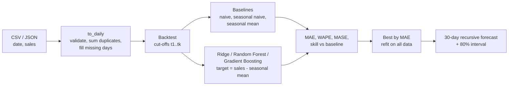

# Retail Sales Forecasting

Upload daily sales, get a 30-day forecast with an uncertainty band, and see how
every model compares with simple baselines on the same backtest.

FastAPI + scikit-learn backend, React + Recharts frontend, both in this repository.

**Live demo:** https://retail-sales-ml.vercel.app (the API sleeps when idle; the first
request can take about a minute).

## Results

<!-- RESULTS:START -->
**Real data:** UCI Online Retail II, daily revenue of a UK online retailer, Dec 2009 –
Dec 2011 (739 days, 135 without trading). Each forecaster makes 30-day forecasts from
5 cut-off dates (Jul–Nov 2011), feeding its own predictions forward. Full tables:
[`backend/reports/benchmark.md`](backend/reports/benchmark.md).

| forecaster | WAPE | MASE | vs "same day last week" |
|---|---|---|---|
| **Gradient Boosting** (predicts deviation from seasonal mean) | **29.8%** | **0.92** | **+13.7%** |
| Random Forest, raw target (first version's approach) | 29.9% | 0.92 | +13.4% |
| Random Forest (deviation) | 30.9% | 0.95 | +10.6% |
| Seasonal mean of last 4 weeks (baseline) | 33.8% | 1.04 | +2.2% |
| Seasonal naive, same day last week (baseline) | 34.5% | 1.06 | 0% |
| Gradient Boosting, raw target (first version's approach) | 34.6% | 1.07 | −0.3% |
| Linear Regression (either target) | 49.2% | 1.52 | −42.6% |

**What the first version showed vs reality:** on its own 365-day sample data the
first version's best model had MAE 198–205 while "same day last week" had 101–112
(3 of 3 random seeds): the models were worse than the simplest baseline, and nothing
in the app could reveal it.

**Findings**

- On real data the best model is **14% better than the seasonal baseline**: a real
  but modest gain. Synthetic data, being generated by a simple formula, flatters the
  models (+45% to +62%) and is reported separately.
- Predicting the deviation from the seasonal mean turns Gradient Boosting from no
  better than the baseline (−0.3%) into the best forecaster (+13.7%); for Random
  Forest it makes no real difference.
- Linear regression degrades over a 30-day recursive forecast and is clearly worse
  than the baseline. The app chooses by backtest, so it is never picked here.

Limits: one real series and 150 forecasted days; no hyperparameter tuning, so the
backtest is not optimized against.
<!-- RESULTS:END -->

## What changed from the first version, and why

The first version trained three models on one 80/20 split and reported their error
on the test days. Measuring it properly showed three problems:

| Problem | Effect | Fix |
|---|---|---|
| No baseline | The models looked fine, but on its own sample data they lost to "same day last week" (see Results) | Three baselines are always evaluated and can win; the app picks whatever is best |
| Wrong test | Each test day was scored with the *true* previous days as inputs, while the real 30-day forecast feeds back its own predictions | Rolling-origin backtest: 30-day recursive forecasts from several cut-off dates, exactly like production |
| Trees cannot extrapolate | Random forest / boosting cannot predict above the highest value they saw (December peak, growth) | Models predict the deviation from the recent same-weekday average; the level comes from the data |

Also: WAPE instead of MAPE (zero-sales days), MASE and skill vs the seasonal naive
forecast, an 80% interval from backtest errors, input validation with clear 400
errors, and the frontend no longer shows **simulated** results when the API is
unavailable (it used to invent metrics and predictions with `Math.random`).

## How it works



Features use only information available before the forecasted day (lags 1, 2, 7, 14,
21, 28; 7/28-day means; weekday; month and day-of-year cycles; days to Christmas).
A test checks this: changing the target day and everything after it does not change
its features.

## Run locally

```bash
# backend
cd backend
python -m venv .venv
.venv\Scripts\activate          # Windows (source .venv/bin/activate elsewhere)
pip install -r requirements-dev.txt
uvicorn main:app --reload        # http://localhost:8000/docs
pytest -q

# frontend
cd frontend
npm install
copy .env.example .env           # VITE_API_URL=http://localhost:8000
npm run dev                      # http://localhost:5173
```

### Benchmark

```bash
cd backend
python -m benchmarks.prepare_online_retail path\to\online+retail+ii.zip   # once
python -m benchmarks.run_benchmark
```

Writes `reports/benchmark.md` and `reports/benchmark.json`. The original pipeline is
kept in `benchmarks/original_pipeline.py` to reproduce the "before" numbers.

## Data format

```csv
date,sales
2023-01-01,1200.50
2023-01-02,1350.75
```

At least 86 days. Duplicate dates are summed, missing dates count as zero sales,
header names are case-insensitive.

## Deployment

- **API (Render):** `render.yaml` (root directory `backend`). The free plan sleeps
  when idle; the first request takes about a minute.
- **Frontend (Vercel):** root directory `frontend`, framework Vite, environment
  variable `VITE_API_URL`.

## Repository layout

```
backend/
  app/forecasting.py     data validation, features, baselines, models, backtest
  app/api.py             FastAPI endpoints
  benchmarks/            before/after benchmark, original pipeline, real dataset prep
  tests/
frontend/src/App.jsx     upload, model comparison, forecast charts
```

The backend and frontend previously lived in `RetailSalesML/retail-sales-api` and
`RetailSalesML/retail-sales-frontend`; their history is merged here.

## Data credits

Online Retail II: Chen, D. (2012), UCI Machine Learning Repository,
https://doi.org/10.24432/C5CG6D, CC BY 4.0.

## License

MIT
